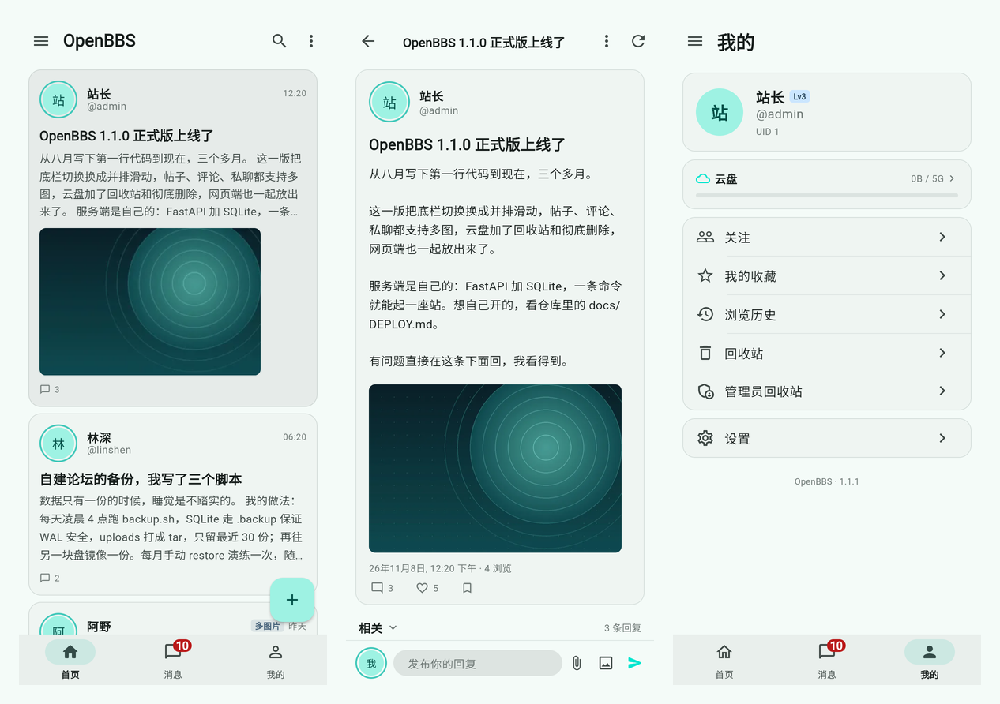

<div align="center">

# OpenBBS

**一个能自己部署的轻论坛 —— 服务端 FastAPI + SQLite，客户端 Flutter，一套代码出 Android / Windows / Web。**

[](LICENSE)
[](server)
[](lib)
[](pubspec.yaml)



</div>

## 这是什么

实用主义至上的集论坛、私聊、云盘为一体的多功能社区。

服务端只有一层：FastAPI 接请求，SQLite 存数据，文件落本地目录。没有 Redis，没有消息队列，没有对象存储。整站是一个目录加一个数据库文件，拷走就能搬，`tar` 一下就能备份。

客户端是 Flutter 写的，安卓、Windows、网页共用一套代码 —— 手机装 APK，电脑开桌面端，别人临时想看就发个网址。

## 功能

**讨论**
- 帖子支持正文 + 多图（九宫格展开，点开看大图）
- 评论、回复、点赞、收藏、关注
- 浏览历史、站内搜索
- 草稿本地保存，切换页面不丢

**私聊与消息**
- 一对一私聊，支持多图
- 未读红点、消息列表按时间排

**云盘**
- 每用户 5 GB 配额，上传的图片和附件都走这里
- 回收站，误删能捞回来；管理员可彻底删除
- 占用进度条在「我的」页直接看

**管理**
- 站点配置、用户管理、内容审核、黑名单
- 一键备份 / 恢复脚本，附校验脚本（大小、表数量、最新一条 id）
- 升级检查：`check_update.sh` 对比版本，客户端里能看到新版本提示

**接入**
- 网页版免安装，发个网址就能看
- `server/BOT_API.md`：给机器人留的接口，脚本和 bot 可以直接发帖、读帖

## 下载

| 平台 | 说明 |
| --- | --- |
| **Android** | [Releases](https://github.com/kalutoex/openbbs/releases) 里下 `OpenBBS-1.1.1-arm64.apk`，arm64，Android 8.0 起，覆盖安装即可 |
| **Windows** | 源码自行构建：`flutter build windows --release` |
| **Web** | 服务端自带，部署完直接访问站点地址 |

Android 包没有上架应用商店。手机上临时用就开浏览器访问站点地址，网页版功能跟客户端一致。

## 快速开始

### 一条命令起站

```bash
git clone https://github.com/kalutoex/openbbs.git
cd openbbs/server
./install.sh      # 交互问答：站名、端口、访问地址
./run.sh          # 起站，默认 http://127.0.0.1:8092
```

`install.sh` 做四件事：查依赖 → 写 `config/site.json` → 建 venv 装依赖 → 建库并生成管理码，最后把下一步该干什么打印出来。重复跑不会覆盖已经填好的值。

非交互也行：

```bash
./install.sh --name 我的站 --port 8092 --url https://bbs.example.com --yes
```

### Docker

```bash
cd server
./install.sh --docker --name 我的站 --port 8092 --url https://bbs.example.com
docker compose up -d --build
docker compose logs -f
```

默认 host 网络，端口由 `config/site.json` 的 `server.port` 决定。IPv6 也能直接用，想套反向代理看 [docs/DEPLOY.md](docs/DEPLOY.md)。

## 客户端

```bash
flutter pub get

flutter build apk --release        # Android
flutter run -d windows             # Windows
flutter build web --release        # Web
```

指向自己的站有两种方式：

- **运行时**：App 内「我的 → 站点」，填地址即可，支持多站点切换和备用通道
- **编译时**：`--dart-define=SERVERS=https://bbs.example.com,https://backup.example.com`（逗号分隔，第一个为主通道）

## 数据与备份

数据只有三样东西：`server/data/` 下的 SQLite 库、`server/uploads/` 下的文件、`config/site.json`。

```bash
cd server
./backup.sh           # 每天跑一次足够，保留最近 30 份
./check_update.sh     # 确认备份文件没被截断
./restore.sh <备份>    # 恢复到空目录再起个临时端口验一遍
```

备份没演练过就不算备份 —— 这条写在脚本注释里，也写在这里。

## 项目结构

```
openbbs/
├── lib/                  Flutter 客户端
│   ├── pages/            页面：首页、帖子、私聊、云盘、设置……
│   ├── store.dart        状态与数据层
│   └── api.dart          HTTP 客户端
├── server/               FastAPI 服务端
│   ├── app/              路由、鉴权、数据库、文件处理
│   ├── web/              编译好的网页版
│   ├── install.sh        一键部署
│   ├── run.sh            起站
│   ├── backup.sh         备份
│   ├── restore.sh        恢复
│   └── docker-compose.yml
└── docs/                 部署、配置、项目说明
```

## 文档

| 文档 | 内容 |
| --- | --- |
| [docs/DEPLOY.md](docs/DEPLOY.md) | 从空机器到能访问，含证书和反向代理 |
| [docs/CONFIG.md](docs/CONFIG.md) | `site.json` 每个配置项的含义 |
| [docs/PROJECT-OVERVIEW.md](docs/PROJECT-OVERVIEW.md) | 项目结构与数据流 |
| [server/BOT_API.md](server/BOT_API.md) | 机器人 / 脚本接入接口 |

## 说明

这个项目最早是自己和几个朋友用，所以接口按需改、偶尔不向后兼容。要拿去开站没问题，但请先跑通备份和恢复再往里放东西。

## 许可

[GPL-3.0](LICENSE)
